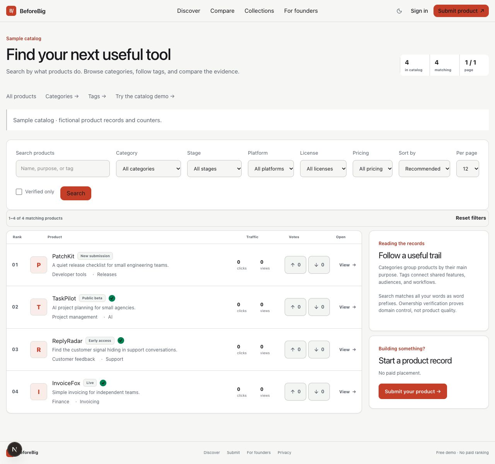

# BeforeBig

**Discover useful software early. Keep the evidence in one place.**

An MIT-licensed software discovery app with searchable product records, thoughtful comparisons, community recommendations, saved collections, and founder-managed galleries. Run it locally, learn from the code, or configure your own instance. **There is no official hosted service.**

[Getting started](#run-the-local-demo) · [Features](#explore-the-project) · [Documentation](#documentation) · [Contributing](CONTRIBUTING.md) · [MIT license](LICENSE)

[](https://github.com/ahmadscience/BeforeBig/actions/workflows/ci.yml)



*Browser preview with fictional data. The included playgrounds work without a database or provider accounts.*

## Run the local demo

Use **Node.js 24** and **pnpm 11.24.0** (pinned in `package.json`).

```bash
corepack enable
corepack prepare pnpm@11.24.0 --activate
pnpm install --frozen-lockfile
cp .env.example .env.local
pnpm dev
```

Open [127.0.0.1:3247](http://127.0.0.1:3247). Keep the reserved port `3247`; `3000` and `3100` may belong to other projects.

The default is **offline demo mode**. Leave `DATABASE_URL` and provider credentials blank: fictional `.example` records support discovery and comparison without a database, email, CAPTCHA, or analytics account. Persistent changes require your own database. URL submissions without persistence create provisional previews, not saved records.

| Playground | Try it |
| --- | --- |
| `/demo/catalog` | Search, pagination, category and tag browsing |
| `/demo/community` | Recommendations, review decisions, support votes, collections |
| `/demo/media` | Private image previews, moderation, gallery covers, removal |
| `/demo/privacy` | Recent sign-in, sample export, deletion consequences |

Playground actions use fictional browser-memory data and reset on reload. They never grant real roles, upload files, export accounts, or delete user data.

## Explore the project

| Area | What is implemented |
| --- | --- |
| Discovery | FTS5 word-prefix search, stable pagination, category/tag pages, metadata filters, and sorting |
| Product evidence | Price, platforms, license/source claims, fit, lifecycle, DNS ownership verification, and founder updates |
| Comparison | Shareable side-by-side comparisons of up to three public records |
| Community | Moderated alternative recommendations, support votes, reviews, authenticated reactions, private downvote reasons |
| Collections | Private by default; public sharing, duplicate-safe saves, removal, and restore |
| Product media | Validated PNG/JPEG/WebP images, metadata stripping, private local/S3-compatible storage, separate moderation, cover selection, cleanup |
| Account privacy | Recent-sign-in JSON export, separate image downloads, session revocation, transactional deletion, explicit product-retention choices |
| Measurement | Browser opt-in controls for internal analytics and optional GA4; Global Privacy Control respected |

Ownership verification proves domain control, not an endorsement of product claims. Sample records cannot accept persistent reactions. Connected demo records have live counters but remain `noindex`.

## Configure your own instance

Start with [setup](docs/SETUP.md) for your own Turso/libSQL database, migrations, authentication, and environment variables. The application uses libSQL's web adapter; a local SQLite file is supported by test/migration tooling, not the application runtime.

- Enable [private media storage](docs/MEDIA.md) before accepting image uploads. Uploads are disabled by default.
- Read [account privacy and deletion](docs/PRIVACY.md) before collecting personal data. Set operator contact, retention, backup, and cleanup processes.
- Keep secrets server-only. Never commit `.env.local`, databases, exports, or private uploads. Use `.env.example` as the configuration reference.

This is an early source project, not a managed service. Payments, traffic guarantees, video uploads, account import, automated provider erasure, and a managed retention worker are not implemented. See the [remaining work](docs/FEATURES.md).

## Develop and verify

Built with **Next.js App Router, React, TypeScript, Drizzle, and Turso/libSQL**. Application code is in `src/`; checked SQL migrations are in `drizzle/`; operational commands are in `scripts/`.

```bash
pnpm typecheck
pnpm lint
pnpm test
pnpm build
# After building, with a browser available and port 3247 free:
pnpm perf:audit
```

`pnpm verify` runs typechecking, lint, tests, and the production build. `pnpm env:check` validates a fully configured hosted instance and intentionally fails for the offline demo. Builds load `.env.local`; use isolated process variables to avoid your database during checks. CI runs the same code checks and Lighthouse budgets.

## Documentation

| Start here | Go deeper |
| --- | --- |
| [Setup & configuration](docs/SETUP.md) | [Architecture](docs/ARCHITECTURE.md) |
| [User workflows](docs/USAGE.md) | [Data model](docs/DATA_MODEL.md) |
| [Privacy, export & deletion](docs/PRIVACY.md) | [Security model](docs/SECURITY.md) |
| [Media storage & cleanup](docs/MEDIA.md) | [Analytics definitions](docs/ANALYTICS.md) |
| [Contributing](CONTRIBUTING.md) | [Features & remaining work](docs/FEATURES.md) |

Bug reports and focused improvements are welcome through [GitHub issues](https://github.com/ahmadscience/BeforeBig/issues) and pull requests. Read [contributor instructions](AGENTS.md) before changing behavior; report sensitive problems using [the security policy](SECURITY.md), not a public issue containing private data.

## License and credits

Released under the [MIT License](LICENSE). Dependency licenses remain their respective authors'. UI refinement used [Unslop by Damir Sokolovsky](https://github.com/heydamir/unslop), licensed [CC BY 4.0](https://creativecommons.org/licenses/by/4.0/); see [credits](CREDITS.md).
